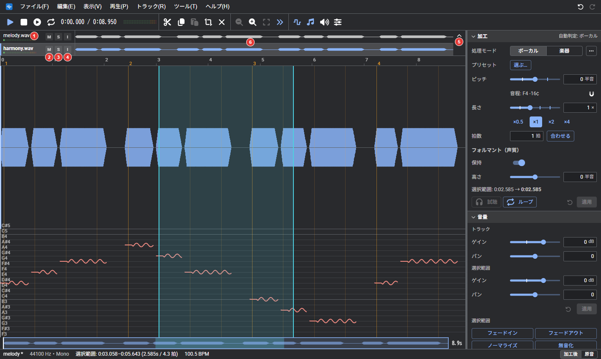

# トラック
複数の音声を重ねるトラックの操作。

複数の音声を並べ、同時に再生しながら編集できる。トラックが 2 本以上あるときのみ、ツールバーの下にトラックの欄が表示される。

| 番号 | 内容 |
| --- | --- |
| 1 | トラックの名前と、音量のつまみ（溝に音量メーターを表示する。ダブルクリックで 0 dB に戻る）。編集中のトラックは明るく表示される |
| 2 | M（ミュート）: このトラックを再生しない |
| 3 | S（ソロ）: このトラックのみを再生する |
| 4 | I（位相反転）: 波形の上下を反転して再生する。他のトラックとの打ち消し合いの確認や修正に使用する。書き出しにも反映され、プロジェクトに保存される |
| 5 | トラックの欄を折りたたむ（タブ表示にする）、展開する |
| 6 | トラックの波形。再生されないトラックは薄く表示される |

| 操作 | 動作 |
| --- | --- |
| トラックをクリック | そのトラックを編集する |
| Ctrl（⌘）+ クリック | トラックを 1 本ずつ選択に追加/解除する |
| Shift + クリック | 編集中のトラックから、クリックしたトラックまでを一括で選択する |
| ドラッグ | トラックを並び替える |
| 右クリック | トラックのメニューを開く |

トラックのメニューでできること:

- 名前の変更、複製、削除
- ボーカルと伴奏に分離する
- 直下のトラックと統合する、すべて統合する
- 他のトラックの波形を、大きな波形の背後に重ねて表示する

トラックを右クリックして「このトラックを書き出す…」を選ぶと、そのトラックを選び、書き出す対象を「選択中のトラックのみ」にして書き出しのダイアログを開く。複数選択して右クリックすると、統合、ミュート、ソロ、削除を一括で行える。並び替えは元に戻せる。

「編集」→「無音を挿入…」で、選択範囲の先頭（なければ再生位置）に、秒または拍で指定した長さの無音を挿入する（後続の音声はその分後ろへ移動する）。貼り付けと無音の挿入のあとは、再生位置が挿入した範囲の末尾へ移動する（「設定」→「全般」→「編集」→「波形の挿入後、再生位置を末尾へ移動」で無効にできる。この設定は貼り付けにも適用される）。

「編集」→「新しいトラックへ」→「選択範囲を新しいトラックへコピー」で、選択範囲を同じ時刻のまま新しいトラックにコピーする（その他の部分は無音）。「…へ移動」の場合は、元のトラックのその部分が無音になる。

トラックを追加するには、「ファイル」→「ファイルをトラックとして追加…」を使用するか、音声ファイルをドロップする。「トラック」→「空のトラックを追加」では、選択中のトラックと同じ長さの無音のトラックを追加できる（貼り付け先として使用する）。インスペクタの「音量」の「トラック」で、トラックごとの音量（ゲイン）とパンを設定する。これは音声を書き換えず、再生と書き出しにそのまま反映される。

書き出す際は、全トラックをミックスするか、選択中のトラックのみにするかを選択できる（[保存と書き出し](save.md)）。

## FX

「トラック」→「FX…」（トラックのメニューからも開ける）で、トラックごとにエフェクトの列を組む。左の列にエフェクトを並べ、上から順に掛ける。右に選んだエフェクトのつまみを表示する。音声は書き換えず、再生と書き出しに反映され、プロジェクトに保存される。FX を使用しているトラックは、トラックの欄の「⋯」に色が付き、メニューの「FX…」にチェックが付く。

| 項目 | 内容 |
| --- | --- |
| 追加 | エフェクトを列の最後に足す。種類は、グラフィック EQ、コンプレッサー、リバーブ、ディレイ、リミッター |
| スイッチ、↑ ↓、× | オンとオフ（オフは素通し）、並び替え、削除 |
| プリセット | 今のつまみの値に名前を付けて保存し、呼び出せる |
| 再生 | 掛けた音を、ダイアログを開いたまま確認する |
| 適用 | FX の列をトラックの音声に書き込み、列を空に戻す（元に戻すの対象になる） |

つまみはダブルクリックで既定値に戻る。入っていないエフェクトを使ったプロジェクトを開くと、そのエフェクトは素通しになる（値は残る）。以前のプロジェクトの EQ は、列の先頭の「グラフィック EQ」に引き継がれる。

### プラグインの追加

設定の「プラグイン」で、プラグインのマニフェストの URL を入れて「追加」を押すと、FX の「追加」に出てくる。追加するときに、作者、版、必要な権限が表示される。

- 追加したプラグインは、この端末に保存される。ネットがなくても使用できる。「更新」で追加した URL から新しい版を取り直し、「×」で削除する
- 追加機能の保存先のフォルダーを選んでいれば、プラグインもそのフォルダーに保存され、ほかの端末やブラウザと共有できる
- 重くて音が途切れるプラグインは、自動で素通しになる（FX のダイアログに表示される。オフにしてからオンにすると、もう一度試す）
- 入っていないプラグインを使ったプロジェクトを開くと、追加を勧める通知が出る
- プラグインは、このアプリと同じ場所で動き、アプリから隔離されない。信頼できる作者のものだけを追加する
- プラグインの作り方は wevocal-lib の plugin-sdk/README.md

### VST（試験的）

Windows の VST2 のプラグイン（DLL）を、エミュレーターで動かして FX として使用できる。試験的な機能で、動かないプラグインもある。

- 使うには、設定の「開発者向け」で「VST（Windows のプラグイン）を読み込めるようにする（試験的）」をオンにする。設定の「プラグイン」に「VST（DLL）を選ぶ」が表示される。DLL のファイルを選ぶか、DLL の URL を入れて「追加」を押す
- DLL は、ブラウザの中のエミュレーター（wasm）で動く。WeVocalSynthの外には出ない。DLL そのものはこの端末に保存され、プロジェクトにはプラグインの名前とつまみの値だけが入る
- つまみの数と名前は DLL から読み取られ、0 から 1 の値で動かす。DLL が自分の画面（つまみの絵）を持つときは、FX のダイアログにその画面が表示され、マウスで操作できる（32 ビットの DLL のみ）。画面の上の「プラグインの画面」と「標準の画面」で、標準のつまみの画面に切り替えられる。画面を持たない、または対応していないものは、標準の画面だけになる
- エミュレーターで動かすため、処理が重い。軽いプラグインは再生中もそのまま掛かり、処理が間に合わないほど重いと、自動で素通しになる。設定の「処理」の「重いプラグインを先に計算して鳴らす（試験的）」をオンにすると、再生位置より先を先に計算して鳴らす（計算が間に合わない所は素通しになる）
- 動かないプラグインの例: 64 ビットの AVX 命令やスレッドを使うもの、画面に高度な描画（OpenGL など）を使うもの、認証（コピーガード）があるもの。読み込めなかったときは、理由が表示される
- 出力に NaN や無限大が出たプラグインは、そのブロックを無音にして、以後は素通しにする
- 利用規約で解析や改変を禁じているプラグインは使わない。自分で作ったもの、使用を許可されているものだけを使用する

### グラフィック EQ

| 項目 | 内容 |
| --- | --- |
| EQ を使用する | オフにすると、設定を残したまま EQ を通さない |
| バンドの数 | 10 バンド（31.5Hz〜16kHz）か 31 バンド（20Hz〜20kHz）。切り替えると、今の曲線に近い値に置き換わる |
| 上限 | 1 バンドの上げ下げの範囲（±12dB か ±24dB） |
| グラフ | なぞると曲線を描ける。Shift を押しながらドラッグすると 1 つのバンドを細かく調整し、Alt を押しながらなぞると周りとなじませる。ダブルクリックで 0dB に戻る |
| 平らにする | すべてのバンドを 0dB に戻す |

### そのほかのエフェクト

| 名前 | つまみ |
| --- | --- |
| WevGate（ノイズゲート） | しきい値、絞る量、アタック、ホールド、リリース。小さい音（息やノイズ）を絞る |
| WevCompressor（コンプレッサー） | しきい値、レシオ、アタック、リリース、ニー、メイクアップ |
| WevDeEsser（ディエッサー） | 周波数、しきい値、レシオ、リリース。サ行の刺さる高域だけを抑える |
| WevFilter（フィルター） | 種類（ハイパス、ローパス、バンドパス、ノッチ）、周波数、Q、傾き（12、24 dB/oct） |
| WevPitch | ピッチ（半音）、フォルマント（半音）、フォルマントを保持、処理方式（Phasera、Vedict）。ピッチとフォルマント（声の響き）を、再生中にそのまま変える簡易版。遅れは Phasera で約 16 ミリ秒、Vedict で約 43 ミリ秒（Vedict は単音の声向けで、声色が自然に残る）。遅れは約 16 ミリ秒 |
| WevDistortion（ディストーション） | ドライブ、種類（ソフト、ハード、フォールド）、音色、出力、ミックス |
| WevDelay（ディレイ） | テンポに合わせる（1/4、1/8、付点 1/8、1/16）、間隔、フィードバック、音色、ミックス |
| WevReverb（リバーブ） | 種類（部屋、ホール、プレート）、大きさ、高域の減衰、ミックス、プリディレイ |
| WevChorus（コーラス） | 速さ、深さ、遅れ、ミックス |
| WevEnsemble（アンサンブル） | 声の数（2 から 8）、速さ、深さ、遅れ、広がり、ミックス。声を重ねて左右に広げる |
| WevLimiter（リミッター） | 天井、リリース |
